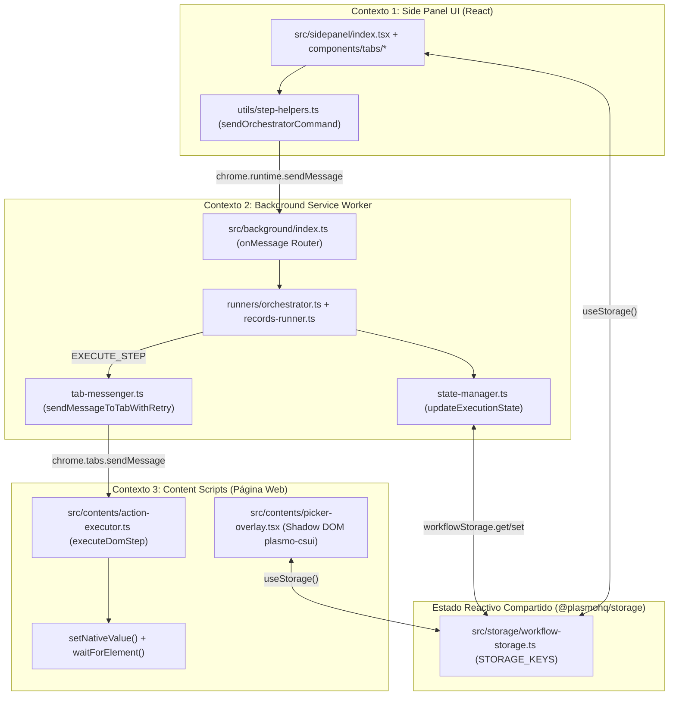
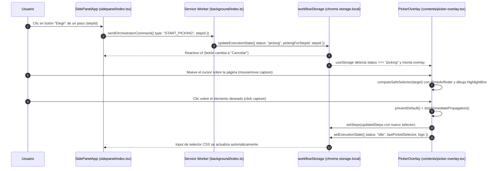
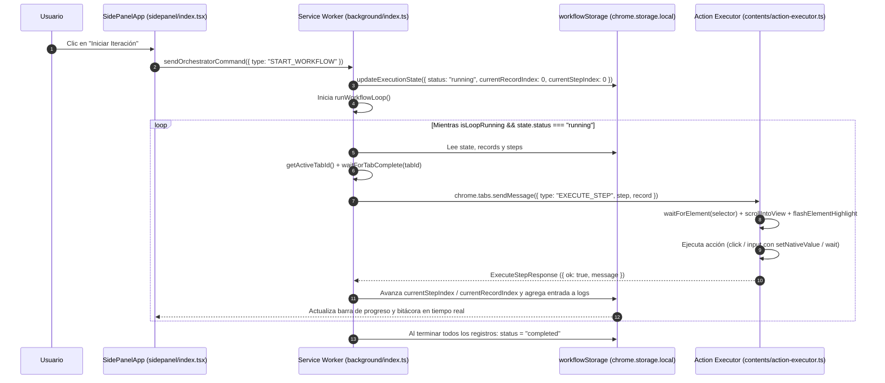
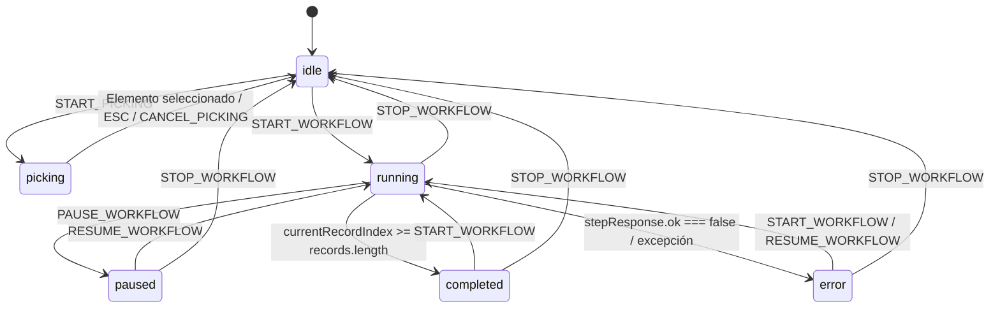

# 01. Arquitectura y Flujos de Datos

**AutoLoop RPA** está construida sobre **Chrome Manifest V3** utilizando el framework **Plasmo**, **React 18**, **TypeScript** y **Tailwind CSS**.

A diferencia de una aplicación web tradicional donde toda la lógica reside en un único proceso de navegador, una extensión de Chrome opera sobre **tres contextos de ejecución aislados** que no comparten memoria directa y deben coordinarse mediante mensajería (`chrome.runtime` / `chrome.tabs`) y almacenamiento reactivo compartido (`@plasmohq/storage`).

---

## 1. Modelo de Tres Contextos Aislados

### Responsabilidades y Límites por Contexto

| Contexto | Archivos fuente | Qué DEBE hacer | Qué NUNCA debe hacer |
| :--- | :--- | :--- | :--- |
| **1. Side Panel UI** | [`src/sidepanel/index.tsx`](../src/sidepanel/index.tsx) `src/sidepanel/components/**` `src/sidepanel/utils/**` | Renderizar el selector de modo (`ModeSelectorBar`), pestañas (`StepsTab`, `DataTab`, `RunTab`), configuración de listas DOM y paginación (`DomListConfigCard`), plantillas (`WorkflowLibraryCard`), parseo CSV/JSON (`records-parser.ts`), exportación de reportes (`workflow-io.ts`) y envío de comandos (`sendOrchestratorCommand`). | **Nunca** ejecutar el bucle iterativo ni intentar acceder al DOM de la pestaña activa directamente. |
| **2. Background Service Worker** | [`src/background/index.ts`](../src/background/index.ts) [`src/background/runners/orchestrator.ts`](../src/background/runners/orchestrator.ts) [`src/background/runners/records-runner.ts`](../src/background/runners/records-runner.ts) [`src/background/runners/dom-list-runner.ts`](../src/background/runners/dom-list-runner.ts) [`src/background/tab-messenger.ts`](../src/background/tab-messenger.ts) [`src/background/state-manager.ts`](../src/background/state-manager.ts) | Ser el **único dueño del bucle de ejecución (`runWorkflowLoop`)**, enrutar según `WORKFLOW_MODE` hacia `runRecordsIteration` o `runDomListExtraction`, resolver la pestaña activa (`getActiveTabId`), esperar a que la pestaña cargue (`waitForTabComplete`) y reintentar el envío de mensajes (`sendMessageToTabWithRetry`). | **Nunca** asumir que existe `window` o `document`. Todo acceso al DOM se delega al Content Script mediante `EXECUTE_STEP`, `INSPECT_LIST_PAGE` o `CLICK_NEXT_PAGE`. |
| **3. Content Scripts (DOM)** | [`src/contents/action-executor.ts`](../src/contents/action-executor.ts) [`src/contents/picker-overlay.tsx`](../src/contents/picker-overlay.tsx) | Ejecutar pasos individuales sobre el DOM global o acotados a un ítem de lista (`executeDomStep`), inspeccionar listas y paginar (`handleInspectListPage`, `handleClickNextPage`), y proveer el selector visual interactivo (`PickerOverlay`) para pasos, contenedores repetitivos y botón Siguiente. | **Nunca** almacenar el estado maestro del bucle en variables locales de la página (si la página navega o se recarga, el contexto del Content Script se destruye). |

---

## 2. Flujos Principales del Sistema

### Flujo A: Selección Visual de Selectores CSS (`PickerOverlay`)

Cuando el usuario pulsa el botón **Elegir** en un paso dentro del Side Panel, se activa el modo de inspección sobre la página web activa sin que el clic del usuario dispare eventos nativos de la página (como abrir enlaces o enviar formularios).

### Flujo B: Ejecución Iterativa del Flujo RPA (`runWorkflowLoop`)

El bucle recorre cada fila de `RECORDS` (`currentRecordIndex`) y, dentro de cada fila, cada paso de `STEPS` (`currentStepIndex`). Al residir en el Service Worker y apoyarse en `waitForTabComplete` + reintentos en `sendStepToTab`, el flujo tolera recargas de página provocadas por envíos de formularios.

---

## 3. Máquina de Estados de `ExecutionState`

El estado global de la extensión está gobernado por la propiedad `status` de `ExecutionState` definida en [`src/types/workflow.ts`](../src/types/workflow.ts):

### Reglas de transición importantes

1. **Idempotencia del bucle (`isLoopRunning`):** En [`src/background/runners/orchestrator.ts`](../src/background/runners/orchestrator.ts), la bandera en memoria `isLoopRunning` evita que se lancen dos instancias simultáneas de `runWorkflowLoop()`.
2. **Doble verificación tras operaciones asíncronas:** Después de esperar la respuesta de `sendMessageToTabWithRetry(...)`, `runRecordsIteration()` vuelve a leer `latestState` mediante `getExecutionState()` antes de escribir el avance de índices. Esto garantiza que si el usuario pulsó **Pausar** o **Detener** mientras un paso estaba en vuelo, su decisión no sea sobrescrita.
3. **Retención acotada de bitácora:** Cada vez que se agrega un mensaje a `logs` mediante `appendLogEntry(prev.logs, text)` en [`src/background/state-manager.ts`](../src/background/state-manager.ts), se conserva únicamente el historial reciente mediante `...logs.slice(-99)` (máximo 100 entradas) para no saturar `chrome.storage.local`.
