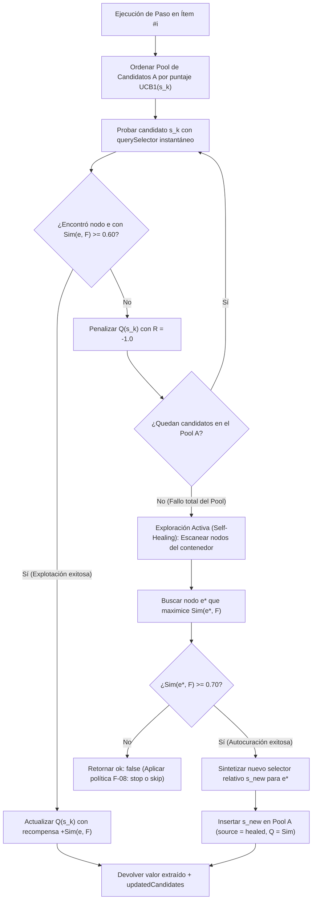
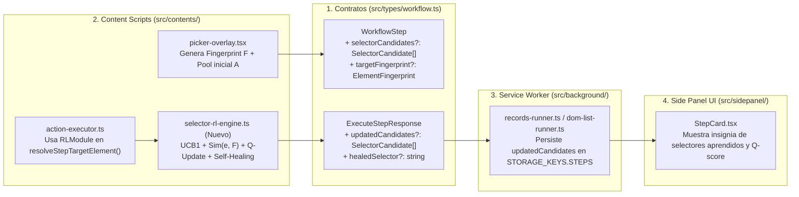

# 04. Motor de Selectores Autocurativos con Aprendizaje por Refuerzo (Self-Healing Locators)

Este documento describe el fundamento teórico, el modelo matemático y el diseño de integración arquitectónica para dotar a **AutoLoop RPA** de un motor de **Selectores Autocurativos (*Self-Healing Selectors*)** basado en **Aprendizaje por Refuerzo (Reinforcement Learning — Contextual Multi-Armed Bandits + Tabular $Q$-Learning)**.

---

## 1. Planteamiento del Problema: El DOM Polimórfico en Listas Web

En aplicaciones web modernas (especialmente catálogos de e-commerce, portales inmobiliarios y feeds dinámicos construidos con React, Next.js o Vue), una lista de $N$ tarjetas visualmente equivalentes rara vez posee un árbol DOM idéntico en sus $N$ elementos. En la práctica, coexisten múltiples **variantes estructurales (DOM Polimórfico)** dentro de un mismo listado:

1. **Variante Estándar:** Tarjeta con estructura base (`div > a > span.price`).
2. **Variante Promocional / Patrocinada:** Inserta nodos adicionales (badges de *"Patrocinado"*, *"Envío Gratis"* o etiquetas de descuento) que alteran la profundidad o los índices `:nth-child` / `:nth-of-type`.
3. **Variante Condicional de Negocio:** Productos con múltiples precios (precio normal, precio internet, precio tarjeta fidelidad) o sin stock, donde el dato buscado cambia de contenedor o de clase CSS.

Cuando un paso de extracción depende de **un único selector CSS estático**:
- Si el selector es **demasiado específico**, falla en las variantes estructurales (provocando esperas innecesarias por timeout y pérdida de datos).
- Si el selector es **demasiado genérico**, corre el riesgo de capturar un nodo incorrecto (por ejemplo, el precio tachado en lugar del precio activo).

---

## 2. Fundamento Teórico: Aprendizaje por Refuerzo Aplicado al DOM

El problema de elegir el mejor selector para localizar un componente web a través de múltiples iteraciones y aprender nuevas rutas cuando la estructura cambia se modela formalmente como un **Multi-Armed Bandit Contextual No Estacionario (CMAB)** con **Actualización de Valor de Acción ($Q$-Learning de horizonte 1)** y **Síntesis Heurística de Acciones**.

### 2.1 Elementos Formales del Agente RL

1. **Conjunto de Acciones (Pool de Selectores Candidatos $\mathcal{A}$):**
   Cada paso `WorkflowStep` mantiene una memoria ordenada de $K$ selectores candidatos:
   $$\mathcal{A} = \{ s_1, s_2, \dots, s_K \}$$
   Donde cada candidato $s_k$ representa una estrategia distinta de localización relativa al contenedor (selector estructural, selector por clases semánticas, selector por prefijo de atributo, ruta de etiquetas o selectores aprendidos en corridas previas).

2. **Estado / Contexto ($\mathcal{S}$) y Huella del Objetivo ($\mathcal{F}$ — *Target Fingerprint*):**
   Al momento en que el usuario selecciona el elemento de ejemplo en el `PickerOverlay`, la extensión captura una **Huella Estructural y Semántica ($\mathcal{F}$)** del elemento objetivo:
   - **`tagName`:** Etiqueta HTML esperada (ej. `"span"`, `"img"`, `"a"`, `"b"`).
   - **`stableClasses`:** Tokens de clases CSS estables del elemento y de su padre inmediato (ej. `["price", "primary", "copy10"]`).
   - **`attributeKeys`:** Nombres de atributos relevantes presentes en el nodo original (ej. `["src", "alt"]` o `["href", "title"]`).
   - **`textPattern`:** Patrón morfológico del valor extraído originalmente:
     - `"currency"` (contiene símbolos monetarios `S/`, `$`, `€` y dígitos).
     - `"number"` (valor numérico o porcentaje).
     - `"url"` (ruta o enlace `http(s)://`).
     - `"text"` (texto descriptivo general).
   - **`relativeBox`:** Posición geométrica normalizada dentro del contenedor repetitivo $(\hat{x}, \hat{y}) \in [0, 1]^2$, calculada como:
     $$\hat{x} = \frac{x_{\text{elem}} - x_{\text{item}}}{W_{\text{item}}}, \quad \hat{y} = \frac{y_{\text{elem}} - y_{\text{item}}}{H_{\text{item}}}$$

3. **Función de Similitud ($\text{Sim}(e, \mathcal{F}) \in [0, 1]$):**
   Dado cualquier nodo candidato $e$ dentro del contenedor actual, su similitud respecto a la huella original $\mathcal{F}$ se define como una combinación lineal convexa ($\sum w_i = 1$):
   $$\text{Sim}(e, \mathcal{F}) = w_{\text{tag}} \cdot \mathbb{I}_{\text{tag}}(e, \mathcal{F}) + w_{\text{cls}} \cdot J(\text{cls}(e), \mathcal{F}_{\text{cls}}) + w_{\text{pat}} \cdot \mathbb{I}_{\text{pat}}(e, \mathcal{F}) + w_{\text{geo}} \cdot \left(1 - \frac{\| (\hat{x}_e, \hat{y}_e) - (\hat{x}_{\mathcal{F}}, \hat{y}_{\mathcal{F}}) \|_2}{\sqrt{2}}\right)$$
   Donde:
   - $\mathbb{I}_{\text{tag}} \in \{0, 1\}$ indica coincidencia de etiqueta HTML (o familia semántica equivalente).
   - $J(A, B) = \frac{|A \cap B|}{|A \cup B|}$ es el índice de similitud de Jaccard sobre las clases estables.
   - $\mathbb{I}_{\text{pat}} \in \{0, 1\}$ valida si el contenido extraído cumple el mismo patrón morfológico (`currency`, `url`, etc.).
   - El último término mide la proximidad espacial relativa dentro de la tarjeta.

4. **Función de Recompensa ($R_t \in [-1, +1]$):**
   Cuando el agente ejecuta un selector $s_k$ sobre el contenedor $t$:
   $$R_t(s_k) = \begin{cases} -1.0 & \text{si } s_k \text{ no devuelve ningún nodo o el valor extraído es vacío} \\ -0.5 & \text{si devuelve un nodo } e \text{ pero } \text{Sim}(e, \mathcal{F}) < \tau_{\min} \text{ (falso positivo)} \\ +\text{Sim}(e, \mathcal{F}) & \text{si devuelve un nodo válido con } \text{Sim}(e, \mathcal{F}) \ge \tau_{\min} \end{cases}$$

### 2.2 Regla de Actualización ($Q$-Learning) y Selección de Acción (UCB1)

Cada selector candidato $s_k \in \mathcal{A}$ almacena un valor de calidad estimado $Q_t(s_k) \in [-1, 1]$ y contadores de éxito/fallo ($n^+(s_k), n^-(s_k)$).

- **Actualización de Rescorla-Wagner / TD(0) con paso constante $\alpha$:**
  Para adaptarse a cambios en la página entre distintas ejecuciones (entorno no estacionario), tras evaluar $s_k$ con recompensa $R_t$:
  $$Q_{t+1}(s_k) = Q_t(s_k) + \alpha \Big( R_t(s_k) - Q_t(s_k) \Big), \quad \alpha \in [0.15, 0.30]$$

- **Política de Ordenamiento por Límite Superior de Confianza (UCB1):**
  Al procesar el siguiente ítem de la lista, el agente ordena su pool de selectores candidatos según el puntaje UCB1, que equilibra **explotación** (usar el selector con mayor $Q$) y **exploración controlada** (probar candidatos prometedores poco evaluados):
  $$\text{UCB1}(s_k) = Q_t(s_k) + c \sqrt{\frac{\ln(N_{\text{total}} + 1)}{n(s_k) + 1}}$$

### 2.3 Exploración Activa y Síntesis de Nuevos Selectores (*Self-Healing*)

Si en un ítem particular **todos** los selectores actuales del pool $\mathcal{A}$ fallan ($R < 0$), el agente no aborta inmediatamente ni espera un timeout largo:
1. **Escaneo del Sub-árbol DOM del Contenedor:** Recorre los nodos descendientes del contenedor actual `container.querySelectorAll("*")` (típicamente 20 a 60 nodos por tarjeta, lo cual toma $< 2\text{ ms}$).
2. **Maximización de Similitud:** Calcula $\text{Sim}(e, \mathcal{F})$ para cada nodo descendiente y selecciona el nodo óptimo:
   $$e^* = \arg\max_{e \in \text{ Container}} \text{Sim}(e, \mathcal{F})$$
3. **Condición de Curación (*Healing Threshold*):** Si $\text{Sim}(e^*, \mathcal{F}) \ge \tau_{\text{heal}}$ (ej. $0.70$):
   - Sintetiza un nuevo selector CSS relativo $s_{\text{new}}$ para $e^*$ dentro del contenedor.
   - Agrega $s_{\text{new}}$ al pool $\mathcal{A}$ con `source: "healed"` y un valor inicial $Q_0(s_{\text{new}}) = \text{Sim}(e^*, \mathcal{F})$.
   - Persiste el pool actualizado en `workflowStorage` (`STORAGE_KEYS.STEPS`).

---

## 3. Flujo de Ejecución y Aprendizaje Entre Corridas



### Comportamiento en Corridas Sucesivas (Memoria a Largo Plazo)

| Fase | Qué ocurre en el motor RL | Impacto en rendimiento y precisión |
| :--- | :--- | :--- |
| **1. Captura Inicial (`PickerOverlay`)** | El usuario hace clic en un dato de la primera tarjeta. Se guarda la huella $\mathcal{F}$ y un pool inicial de 3 a 5 candidatos ($s_1 \dots s_5$) con $Q_0$ proporcional a su cobertura en la página actual. | El paso nace con múltiples rutas alternativas en lugar de un único selector frágil. |
| **2. Primera Corrida (Aprendizaje Online)** | Cuando aparece una tarjeta con variante estructural (ej. ítem #14), el candidato $s_1$ falla en $< 1\text{ ms}$, pero $s_2$ acierta (o el explorador activo sintetiza $s_{\text{new}}$). Se actualizan los valores $Q$. | No se pierden 4.5 segundos de timeout por ítem variante y se captura el dato sin intervención humana. |
| **3. Siguientes Corridas (Explotación Memorizada)** | Como `updatedCandidates` se persiste en `STORAGE_KEYS.STEPS` (y en `SavedWorkflow` / JSON exportado), la siguiente ejecución ya conoce todos los selectores de las variantes y los prioriza por su $Q$-Value. | Extracción inmediata en todas las variantes desde el primer intento. |

---

## 4. Integración en la Arquitectura Actual de AutoLoop RPA (MV3)

La arquitectura modular implementada en `v0.4.1` — `v1.0.1` permite integrar este motor de forma limpia en las **5 capas** sin romper la separación de contextos de Chrome Manifest V3:



---

### 4.1 Capa 1: Contratos y Tipos ([`src/types/workflow.ts`](../src/types/workflow.ts))

Se extienden `WorkflowStep` y `ExecuteStepResponse` manteniendo total retrocompatibilidad con los flujos JSON ya existentes:

```typescript
export type TextPatternType = "currency" | "number" | "url" | "text"

export interface ElementFingerprint {
  tagName: string
  stableClasses: string[]
  parentClasses: string[]
  attributeNames: string[]
  textPattern: TextPatternType
  relativeBox?: {
    topRatio: number
    leftRatio: number
  }
}

export interface SelectorCandidate {
  selector: string
  qValue: number
  successCount: number
  failCount: number
  source: "initial" | "healed"
}

export interface WorkflowStep {
  id: string
  type: ActionType
  label: string
  selector?: string
  /** Pool de candidatos gestionado por Aprendizaje por Refuerzo */
  selectorCandidates?: SelectorCandidate[]
  /** Huella estructural y semántica del elemento objetivo para exploración autocurativa */
  targetFingerprint?: ElementFingerprint
  // ... resto de propiedades existentes
}

export interface ExecuteStepResponse {
  ok: boolean
  message: string
  extractedValue?: string
  /** Si los Q-values cambiaron o se descubrió un nuevo selector por exploración */
  updatedCandidates?: SelectorCandidate[]
  /** Selector sintetizado si se activó la autocuración en este paso */
  healedSelector?: string
}
```

---

### 4.2 Capa 2: Content Scripts (`src/contents/`)

1. **Nuevo módulo dedicado `src/contents/selector-rl-engine.ts`:**
   Encapsula toda la matemática del agente para mantener limpio `action-executor.ts`:
   - `buildElementFingerprint(el: Element, container?: Element): ElementFingerprint`
   - `computeSimilarityScore(candidateEl: Element, fingerprint: ElementFingerprint, container?: Element): number`
   - `rankCandidatesByUCB1(candidates: SelectorCandidate[]): SelectorCandidate[]`
   - `updateCandidateQValue(candidate: SelectorCandidate, reward: number, alpha = 0.2): SelectorCandidate`
   - `exploreAndHealInContainer(container: Element, fingerprint: ElementFingerprint): { element: HTMLElement; synthesizedSelector: string; similarity: number } | null`

2. **Captura de Huella y Pool Inicial en [`src/contents/picker-overlay.tsx`](../src/contents/picker-overlay.tsx):**
   - Al hacer clic sobre un elemento para configurar un paso (`pickingTarget === "step"`), además de asignar `step.selector` (el mejor candidato inicial), guarda:
     - `step.targetFingerprint`: construido con `buildElementFingerprint(target, itemRoot)`.
     - `step.selectorCandidates`: los 3–5 candidatos válidos generados durante la inspección inicial, inicializados con $Q_0 = \frac{\text{matched}}{\text{total}}$.

3. **Resolución Adaptativa en [`src/contents/action-executor.ts`](../src/contents/action-executor.ts):**
   - En `resolveStepTargetElement`:
     1. Ordena `step.selectorCandidates` mediante `rankCandidatesByUCB1`.
     2. Prueba cada candidato de forma inmediata (`container.querySelector(cand.selector)`).
     3. Si uno coincide y supera el umbral de similitud con `targetFingerprint`, actualiza su $Q$-Value positivamente (y penaliza los candidatos previos que fallaron en ese ítem).
     4. Si ningún candidato del pool encuentra el elemento, invoca `exploreAndHealInContainer(container, step.targetFingerprint)`:
        - Si descubre un nodo con $\text{Sim} \ge 0.70$, genera su selector CSS relativo, lo añade a `selectorCandidates` con `source: "healed"` y retorna el nodo junto con `updatedCandidates` y `healedSelector`.

---

### 4.3 Capa 3: Orquestador Background ([`src/background/runners/dom-list-runner.ts`](../src/background/runners/dom-list-runner.ts) y [`records-runner.ts`](../src/background/runners/records-runner.ts))

Cuando `sendMessageToTabWithRetry` devuelve `stepResponse`:
- Si viene `stepResponse.updatedCandidates`:
  - Actualiza el paso correspondiente dentro de `STORAGE_KEYS.STEPS` (y actualiza `step.selector` al candidato con mayor `qValue` si superó al principal).
- Si viene `stepResponse.healedSelector`:
  - Registra en la bitácora (`ExecutionState.logs`):
    `[Auto-Heal] Nuevo selector aprendido "${stepResponse.healedSelector}" en Ítem #${currentRecordIndex + 1}`.

---

### 4.4 Capa 4: Interfaz Side Panel ([`src/sidepanel/components/StepCard.tsx`](../src/sidepanel/components/StepCard.tsx) y [`workflow-io.ts`](../src/sidepanel/utils/workflow-io.ts))

1. **En `StepCard.tsx`:**
   - Mostrar debajo del input de selector un indicador compacto cuando `step.selectorCandidates` tenga más de 1 candidato o candidatos aprendidos (`source === "healed"`), permitiendo ver cuántas variantes conoce el paso (ej. `3 selectores en memoria (1 auto-aprendido) · Confianza 94%`).
2. **En `workflow-io.ts` y `WorkflowLibraryCard.tsx`:**
   - Conservar `selectorCandidates` y `targetFingerprint` al guardar en la biblioteca local (`SAVED_WORKFLOWS`) y al exportar/importar archivos `.json`, de modo que el aprendizaje adquirido sea portable.

---

## 5. Hiperparámetros Recomendados por Defecto

| Parámetro | Símbolo | Valor por defecto | Justificación técnica |
| :--- | :---: | :---: | :--- |
| **Tasa de aprendizaje** | $\alpha$ | `0.20` | Permite que 4–5 aciertos consecutivos consoliden un selector nuevo sin olvidar abruptamente un selector que solo falló en 1 ítem atípico. |
| **Coeficiente de exploración UCB1** | $c$ | `0.35` | Prioriza el selector con mejor $Q$-Value histórico pero permite probar el segundo candidato si el principal empieza a degradarse. |
| **Umbral mínimo de validación** | $\tau_{\min}$ | `0.55` | Evita falsos positivos cuando un selector genérico coincide con un elemento de otra naturaleza. |
| **Umbral de autocuración (*Healing*)** | $\tau_{\text{heal}}$ | `0.70` | Exige alta coincidencia (etiqueta + patrón de texto + zona geométrica/clases) antes de sintetizar y memorizar un selector nuevo por exploración libre. |
| ** Tamaño máximo del Pool por paso** | $K_{\max}$ | `6` | Mantiene acotada la memoria en `chrome.storage.local`; si se supera, se poda el candidato con menor $Q$-Value. |
